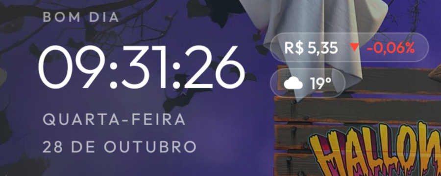

# Home glance: dólar e tempo na tela inicial

Adições deste fork (branch `lucas-home-widgets`) ao launcher CleanYourTV para Fire OS 6 (Fire TV Stick 4K, 1ª geração):

- **Cotação USD/BRL** ao lado do relógio, com seta de alta/queda e variação (fonte: AwesomeAPI). Ao clicar, abre um gráfico das últimas 24 h (`DollarChartView`).
- **Tempo atual** com ícone de sol, nuvem ou chuva (fonte: Open-Meteo), configurado para Rio do Sul/SC.
- **Relógio com segundos** e a data na linha de baixo.
- Cache de 10 min em SharedPreferences, rede fora da UI thread, sem bibliotecas novas.
- Testes de parsing em JVM puro: `HomeGlanceDataTest`.

## Arquivos
- `HomeGlance.java`: busca, cache e UI.
- `HomeGlanceData.java`: parsing sem Android (cotação, série, tempo).
- `DollarChartView.java`: gráfico de linha em Canvas.
- `res/layout/home_glance.xml` e `dialog_dollar_chart.xml`.
